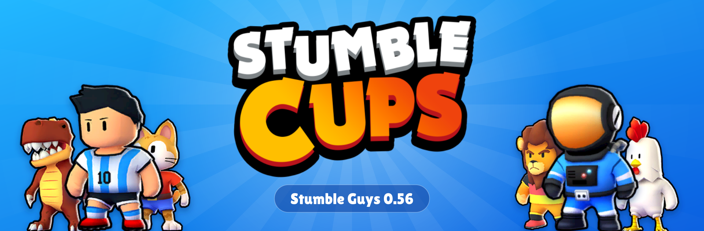
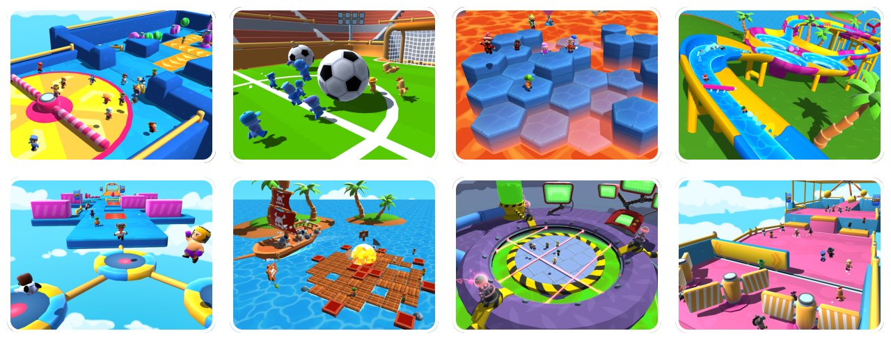
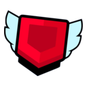
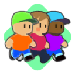
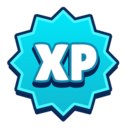
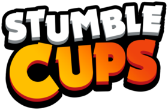

  

  
  

## What is Stumble Cups?

Stumble Cups brings back **Stumble Guys 0.56** on community-run servers: the classic maps and the feel of that version, with a redesigned interface, custom rooms and tournaments built in.

  

## Features

<table>
  <tr>
    <td width="50%"><b>Tournament X</b> Competitive seasons with their own leaderboard. Play, score and climb.</td>
    <td width="50%"><b>Classic Tournaments</b> The original tournament format is back, with its own rankings.</td>
  </tr>
  <tr>
    <td><b>Custom Rooms</b> Create your own room, set the options and invite your friends.</td>
    <td><b>Redesigned UI</b> A refreshed lobby, party screen, custom rooms and in-match HUD.</td>
  </tr>
  <tr>
    <td><b>Cups Pass</b> A seasonal pass packed with rewards to unlock as you play.</td>
    <td><b>Clans</b> Create or join a clan, with its own chat.</td>
  </tr>
  <tr>
    <td><b>Friends and Parties</b> Add friends, see who's online and queue up together.</td>
    <td><b>Events and XP Road</b> Limited-time events, plus rewards for every level you gain.</td>
  </tr>
</table>

## Servers

Play on the region closest to you for the best ping:

<table>
  <tr>
    <td align="center" width="20%">🇧🇷 <b>South America</b></td>
    <td align="center" width="20%">🇺🇸 <b>United States</b></td>
    <td align="center" width="20%">🇪🇺 <b>Europe</b></td>
    <td align="center" width="20%">🇮🇳 <b>India</b></td>
    <td align="center" width="20%">🌏 <b>Asia</b></td>
  </tr>
</table>

## How to play

  
  
  

1. Join the [Stumble Cups Discord](https://discord.gg/cups).
2. Download the game for your platform (PC, Android or iOS) right from the Discord.
3. Log in, pick your region and jump into a match.

Updates, tournament schedules and announcements are posted on Discord first. That's also the place to get help, report bugs or suggest features.

## Team

Stumble Cups is run by:

<table>
  <tr>
    <td align="center" width="140"><a href="https://github.com/xDaswx"> <b>Dasw</b></a> @xDaswx</td>
    <td align="center" width="140"><a href="https://github.com/rxvefr"> <b>rxve</b></a> @rxvefr</td>
    <td align="center" width="140"><a href="https://github.com/alonexmz7"><b>alonexmz7</b></a> @alonexmz7</td>
  </tr>
</table>

> [!NOTE]
> Stumble Cups is an **unofficial fan project**. It is not affiliated with, endorsed by, or sponsored by Scopely or Kitka Games. *Stumble Guys* and all related assets are trademarks of their respective owners.

---

   
  See you in the cups!

